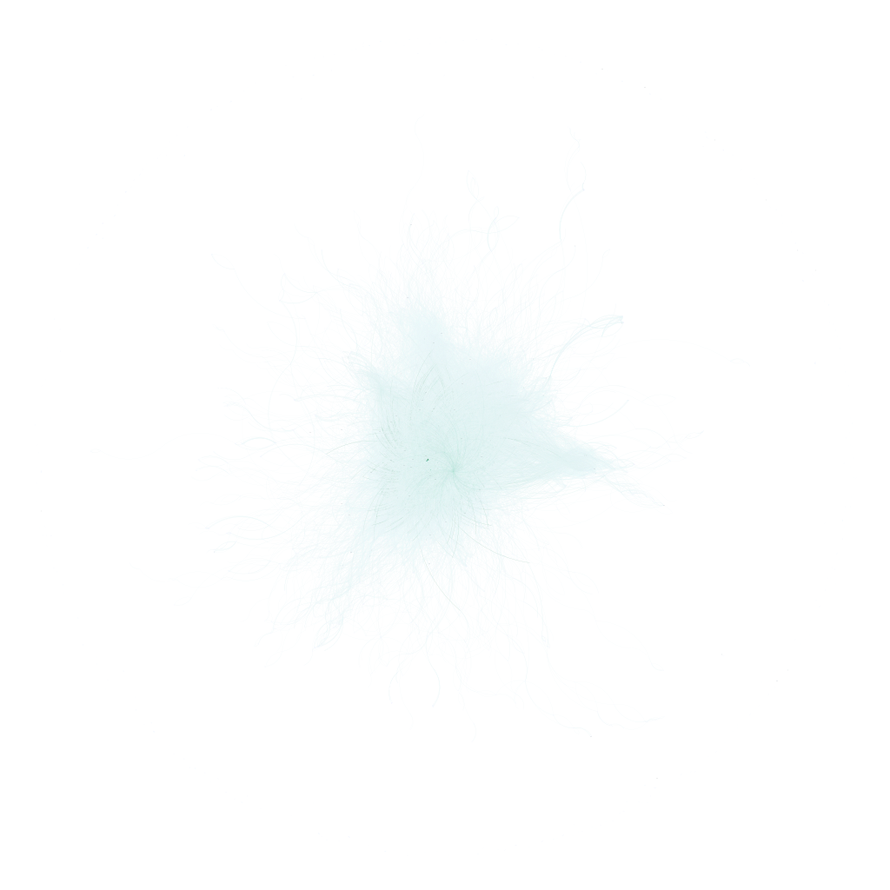

## What Is A Network?

- Networks are a subset of graph theory.

- The idea is to model and analyze relationships between entities (**nodes**) and their connections (**edges**).

## Networks Are Everywhere

- Natural networks appear in biology, physics, and chemistry.

- Social networks appear in sociology, economics, and organizational research.

- Networks also appear in computer science, engineering, and telecommunications.

## Prior Research: Networks and Graph Theory

## Networks and Organizational Functioning

- The use of networks in organizational research dates back to the 1970s. 

- A review of 187 articles by Chen et al. (2022) found 3 main categories of network dynamics research in organizations:

1. **Network Change**: Emergence, evolution, and transformation of network ties and structures.

2. **Relational Events**: Sequence of discrete actions generated by one actor and directed towards others.

3. **Coevolution**: The network and actor attributes influence each other over time.

## Network Communities

- Network communities are groups of nodes that are more densely connected to each other than to the rest of the network.

- Communities can be detected using various algorithms, such as the Louvain method, which optimizes modularity to identify clusters of nodes.

## Community Promiscuity

- Community promiscuity refers to the extent to which nodes are distributed across multiple communities within the network.

- Promiscuity in the context of networks refers to the tendency of songwriters to collaborate with a large number of different partners, rather than focusing on a small, stable group.

- $\psi_i = \frac{k_i}{K}$

- $k_i$: The number of unique communities to which node i belongs.

- $K$: The total number of communities in the network.

- A high score of 1 means the node participates in every single community in the network, while a low score means its allegiance is highly localized.

## Hypotheses

H_1: Strong communities will appear within the songwriter network, indicating that certain groups of songwriters frequently collaborate with each other.

H_2: Promiscuity will be normally distributed across the entire network.

H_3: Songwriters with higher centrality measures (e.g., degree, betweenness) will have a greater influence on the overall structure of the network, potentially acting as bridges between different communities. 

H_4: Songwriter performance will be positively related to centrality measures. 

##

## Implications

## Future Research

- Transition from static promiscuity and flexibility to dynamic measures that capture changes over time. 